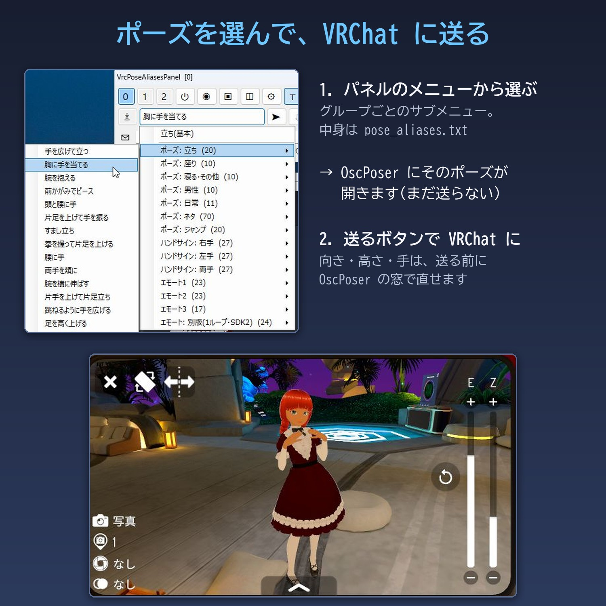
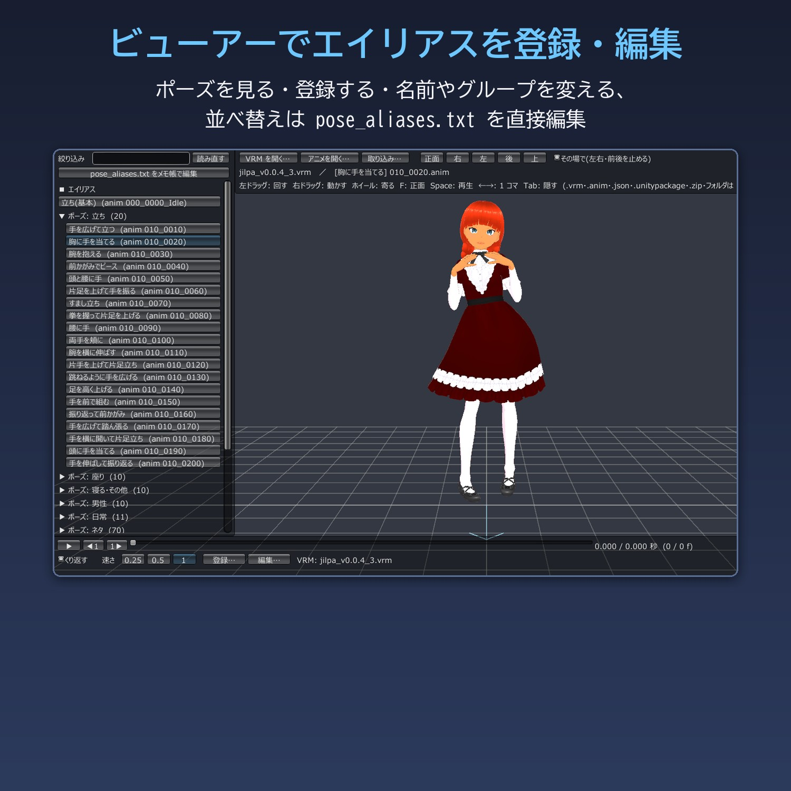
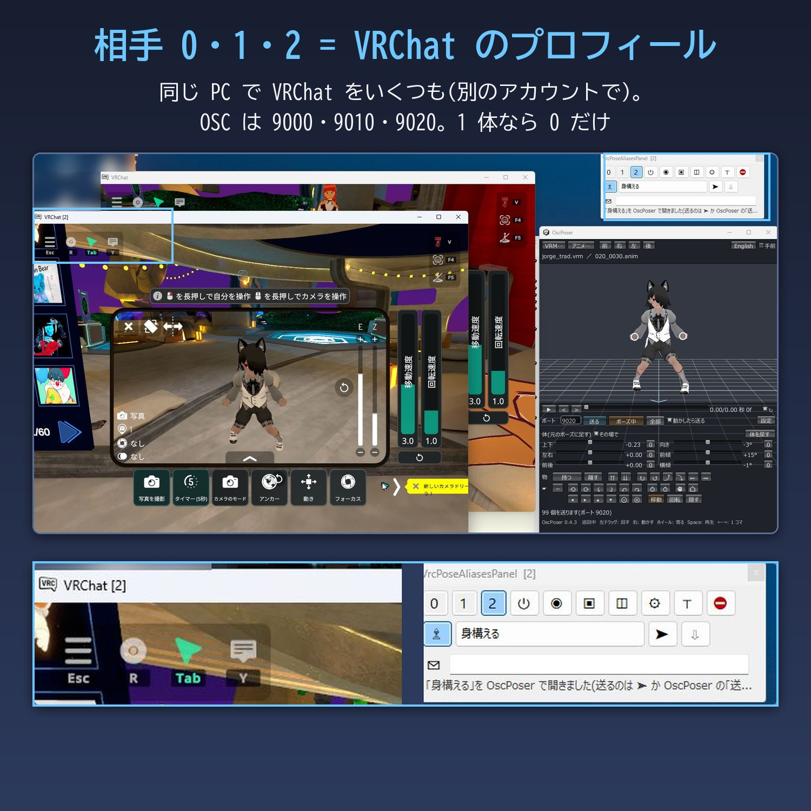

# VrcPoseAliasesPanel

[日本語](README.md)

A small control panel that makes your VRChat avatar take poses you have registered by name (**aliases**).

It was made as **an example of using [OscPoser](https://github.com/JRF-2018/osc_poser) through its control interface (the same one its MCP uses)**. OscPoser is what sends poses to VRChat; this panel only asks OscPoser to "open this pose" and "send it" — the same thing an AI (Claude Code etc.) does through MCP, done with buttons.

Conversely, **you do not need this panel to use OscPoser**; OscPoser alone opens and sends any .anim. This panel is for keeping your favorite poses named and lined up so you can pick them quickly. The author (JRF) uses a somewhat extended version of it (walking, holding objects, ...) for photographing worlds.



This panel is not a self-contained tool, and **it takes some effort to get started**. You need OscPoser working, and you build your own list of poses (aliases). Please read this README through before using it.

- Panel: `VrcPoseAliasesPanel.exe` (C# WinForms, runs on .NET Framework 4.8, which comes with Windows)
- Viewer: `VrmPoseViewer\VrmPoseViewer.exe` (shows a pose on a VRM; also where you register/edit aliases and import animations)

The example aliases and the panel's sample names are in Japanese. Set the panel's language in ⚙ (English is chosen automatically on non-Japanese Windows); the viewer is in Japanese only.

## What it does

- Choose a target **0, 1, 2** (a VRChat profile number, see [Profiles 0, 1, 2](#profiles)), then:
  - ⏻ launch VRChat with that profile
  - pick a pose from the list (`pose_aliases.txt`) — it opens in OscPoser; ➤ sends it to VRChat; ♙ turns the pose on/off; ⇩ saves the current pose
  - ✉ chat (VRChat chatbox)
  - ◉ screenshot a VRChat window (e.g. to show an AI; the path is copied to the clipboard)
- ▣ the viewer: look at poses, register aliases, rename / regroup them, import animations

## Requirements

- Windows 10 / 11
- [OscPoser](https://github.com/JRF-2018/osc_poser) **0.4.0 or later** (the exe and the prefab in your avatar). Follow OscPoser's README, upload your avatar with the prefab, and make sure OscPoser alone can send a pose first.
- VRChat (desktop or VR)

## Install

1. Extract the zip anywhere (e.g. `D:\VrcPoseAliasesPanel_0.1.0\`).
2. Extract OscPoser too, and put its `OscPoser_<version>` folder **inside or next to** this folder; it is then found automatically (the double folder made by "Extract All" is fine). If you put it elsewhere, you are asked for `OscPoser.exe` at startup (or set it in ⚙).
3. Start `VrcPoseAliasesPanel.exe`. If OscPoser is not running, the panel opens it.
4. Open the viewer with ▣ and **first drop a VRM** on it ("VRM を開く…" also works). It is used to check poses (remembered separately from OscPoser's VRM).

To use the example aliases, continue with [Example: Necocoya's free poses and emotes](#example).

## Usage

1. Choose the target with **0 / 1 / 2** (a normally started VRChat is 0).
2. Press the pose button ("(choose a pose)") and pick a pose. It appears in OscPoser's window (not sent to VRChat yet).
3. Press ➤ to send it; the avatar takes the pose (same as OscPoser's Send). Turn the pose off with ♙.

In OscPoser's window you can adjust the body direction/height or move the hands (advanced) before sending. Fine adjustments in OscPoser, choosing poses in the panel.

### Buttons

| | |
|---|---|
| 0 1 2 | Target (VRChat profile number). Launch, poses and chat go there; OscPoser switches too |
| ⏻ | Launch VRChat with the selected profile (finds Steam's launch.exe) |
| ◉ | Screenshot a VRChat window (or the whole screen) to `shots\`; the path is copied |
| ▣ | Open the viewer (showing the chosen pose) |
| ◫ | Bring OscPoser to front (open it if not running) |
| ⚙ | Settings (OscPoser / launch.exe locations, desktop mode, language, ...) |
| ⊤ | Always on top |
| ⛔ | Stop OscPoser's pending sends |
| ♙ | Pose on / off |
| (choose a pose) | The pose menu; picking opens the pose in OscPoser |
| ➤ | Send the current pose to VRChat |
| ⇩ | Save the current pose (including edits in OscPoser) to `poses\<name>.json` |
| ✉ | Chat (Enter to send) |
| bottom line | Recent log; hover for more, double-click to copy |

Dropping a `.vrm` on the panel makes it this target's VRM in OscPoser.

<a id="aliases"></a>
## Aliases (pose_aliases.txt)

The panel's pose list **is the file `pose_aliases.txt`** in this folder. An alias is a name for a pose, which is one of:

- **anim**: an animation (Unity humanoid `.anim`, text format) and a time in it
- **pose**: a saved pose (`poses\<name>.json`, saved with ⇩ or OscPoser)

**We recommend building your own `pose_aliases.txt` from your favorite poses.** The bundled example is far too long; keep what you use and arrange it with your own names and groups.



### Format

```
# from # to the end of line is a comment
Stand        anim  anim/nccy_pose_free/000_0000_Idle.anim
Wave         anim  anim/nccy_emote_free/01_tefuri1.anim  2.57
MyPeace      pose  my_peace

[Sitting]
Cross-legged anim  anim/nccy_pose_free/011_0070.anim
"name with spaces"  anim  "D:\My Anims\sit 01.anim"  f30
```

- One per line: `name  kind  target  [time]`, separated by spaces; quote things with spaces.
- `anim`: a path to a `.anim`, relative to this folder (`anim/...`) or absolute.
- `pose`: the name of a pose in `poses\` (without `.json`).
- Time: seconds (`1.6`), frame (`f30`) or `end` (default). For moving animations, write the moment you want.
- A `[group]` line starts a group (a submenu in the panel) until the next `[...]`. Lines before the first group (the root) are at the top of the menu.
- **The order is the order in the file** (groups and their contents).
- Writing exactly the same line (name, kind, target, time) in another group shows it in both.

### Editing

- **Reorder, delete in bulk, reorganize groups: edit `pose_aliases.txt` directly.** The viewer's "pose_aliases.txt をメモ帳で編集" (edit in Notepad) opens it; when you save, the viewer reloads its list. The panel rereads the file every time you open the menu.
- Adding one at a time, renaming, grouping can also be done in the viewer:
  - **登録… (Register)**: register what you are looking at (an animation at its time, or a saved pose) with a name and groups. Animations from elsewhere are copied into `anim\` first.
  - **編集… (Edit)**: change the name, groups or time, or remove the alias (the file is kept).
  - The viewer keeps the lines it does not change (comments etc.).
- Drop your `.anim` files on the viewer — or a whole `.unitypackage`, `.zip` or folder — to list the animations inside; find the time and register.

<a id="example"></a>
## Example: Necocoya's free poses and emotes

The bundled `pose_aliases.txt` registers 320 poses and emotes from free assets by Necocoya (Kanna Hisashi). **The animations themselves are not included**; get them and import them:

1. Get the free versions of these two on Booth (keep the zips as they are):
   - [Pose set](https://necocoya.booth.pm/items/1634088) (`NCCY_PoseSet_Free_v200.zip` etc.)
   - [Emote set](https://necocoya.booth.pm/items/1065089) (`EmoteSet_Free_v130.zip` etc.)
2. Open the viewer with ▣; the import screen appears ("取り込み…" at the top opens it any time). Drop the zips on the window, or choose them with "参照…" and press "取り込む".
3. Only the registered animations are imported into `anim\`.

The sources are listed in `anim_sources.txt` (`folder  path-prefix-in-package  name  [url]`). Newer versions of the assets still import if the file names stay the same. You can add sources for other assets.

<a id="profiles"></a>
## Profiles 0, 1, 2 (targets)

Started with `--profile=N`, VRChat runs with a separate profile (login and settings). This lets you **run several VRChat clients on one PC at the same time** (each needs its own account, since an account can be logged in at only one place).

The panel's **0, 1, 2 are these profile numbers**. Each VRChat listens on its own OSC port.



| Target | How ⏻ launches it | OSC (in / out) |
|---|---|---|
| 0 | same as a normal start | 9000 / 9001 |
| 1 | `--profile=1 --osc=9010:127.0.0.1:9011` | 9010 / 9011 |
| 2 | `--profile=2 --osc=9020:127.0.0.1:9021` | 9020 / 9021 |

- **With one avatar, 0 is all you need** (a VRChat started normally from Steam is 0).
- Example: 0 = the avatar that poses, 1 = a camera account you operate yourself (no OscPoser prefab needed), 2 = a second avatar.
- ⏻ launches the selected number. A new number starts with VRChat's login. Desktop mode (`--no-vr`) is a setting in ⚙ (on by default).
- The window title of a launched VRChat becomes "VRChat [N]". ◉ also finds windows by number.
- OscPoser is opened with three targets (`-targets 9000,9010,9020`) and follows the panel's target. VRM and pose are kept per target.
- Several clients make the PC heavy; lower the graphics quality and window size of the clients that only pose.

<a id="mcp"></a>
## Using it with AI (MCP)

The panel uses OscPoser's control interface (`-api`, HTTP, port 9330 by default). OscPoser also takes MCP on the same interface, so an AI (Claude Code etc.) can control OscPoser directly (see "Using from AI (MCP)" in OscPoser's README).

For example: prepare VRChat and targets with the panel, let the AI build a pose (open, move hands, look at screenshots, send with OscPoser's MCP), save the result to `poses\` (⇩, or the AI's `save_pose`), and register it in `pose_aliases.txt`.

The panel's code is short (`src/PanelForm.cs`), so it can serve as a model for your own tool that drives OscPoser.

## Settings and files

- ⚙: OscPoser.exe location (empty = search), VRChat launch.exe (empty = search the Steam libraries), desktop mode, OscPoser API port (9330), language.
- Created in this folder: `VrcPoseAliasesPanel.json` (settings), `VrcPoseAliasesPanel_log.txt` (log), `anim\`, `poses\`, `shots\`.
- The viewer's settings (last VRM etc.) are in the registry (`HKEY_CURRENT_USER\Software\JRF\VrmPoseViewer`).

## Troubleshooting

- **Picking a pose does not change the avatar**: did you press ➤ (picking does not send)? Check that OscPoser alone can send and that the avatar has the prefab, and that the target number matches the VRChat you mean.
- **"Animation is missing"**: not imported yet, or the file in `anim\` was moved. Import from the viewer.
- **Not connected to OscPoser** ("(no OscPoser)" in the title): open it with ◫. OscPoser before 0.4.0 has no control interface. An OscPoser started elsewhere without `-api` cannot be used; close it, then ◫.
- **⏻ does nothing**: set VRChat's `launch.exe` in ⚙.

## Building from source

- Panel: `build.ps1`. No .NET SDK needed; it compiles with the C# compiler bundled with Unity 2022.3 (`-Unity` sets Unity's Editor folder).
- Viewer: `viewer/` (a Unity 2022.3.22f1 project using UniVRM 0.128.1), `viewer/build.ps1`.

## Author

JRF ( http://jrf.cocolog-nifty.com/statuses , Twitter (X): @jion_rockford )
AI

Mostly written by Claude Opus 5.5.

## License

MIT License (LICENSE).

The viewer includes UniVRM (MIT License) and more; see [THIRD_PARTY_NOTICES.md](THIRD_PARTY_NOTICES.md).

The bundled example `pose_aliases.txt` only lists the names and locations of Necocoya's assets and contains no animations. Use the assets according to their own terms.
