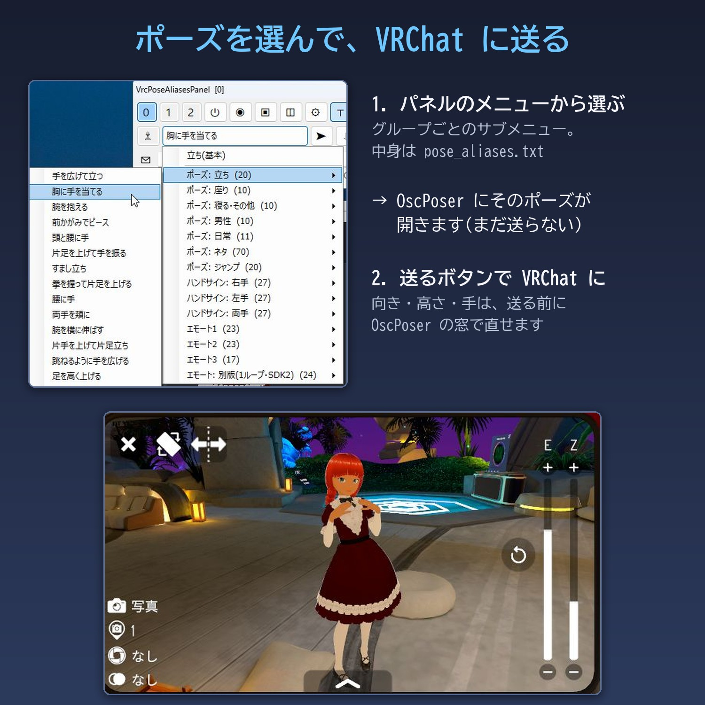
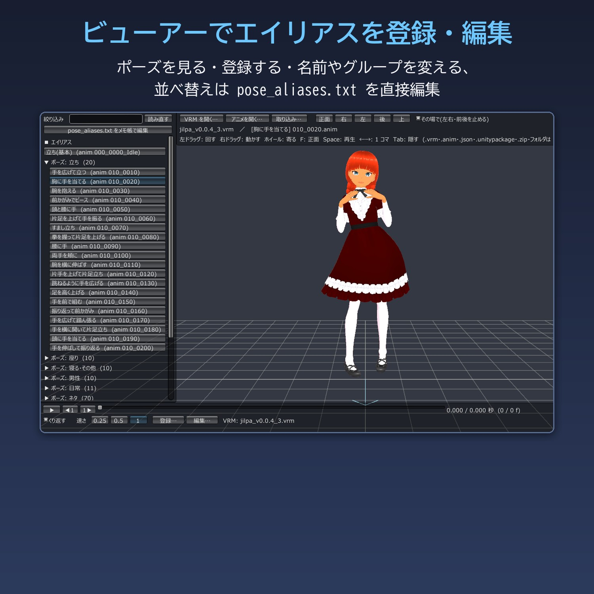
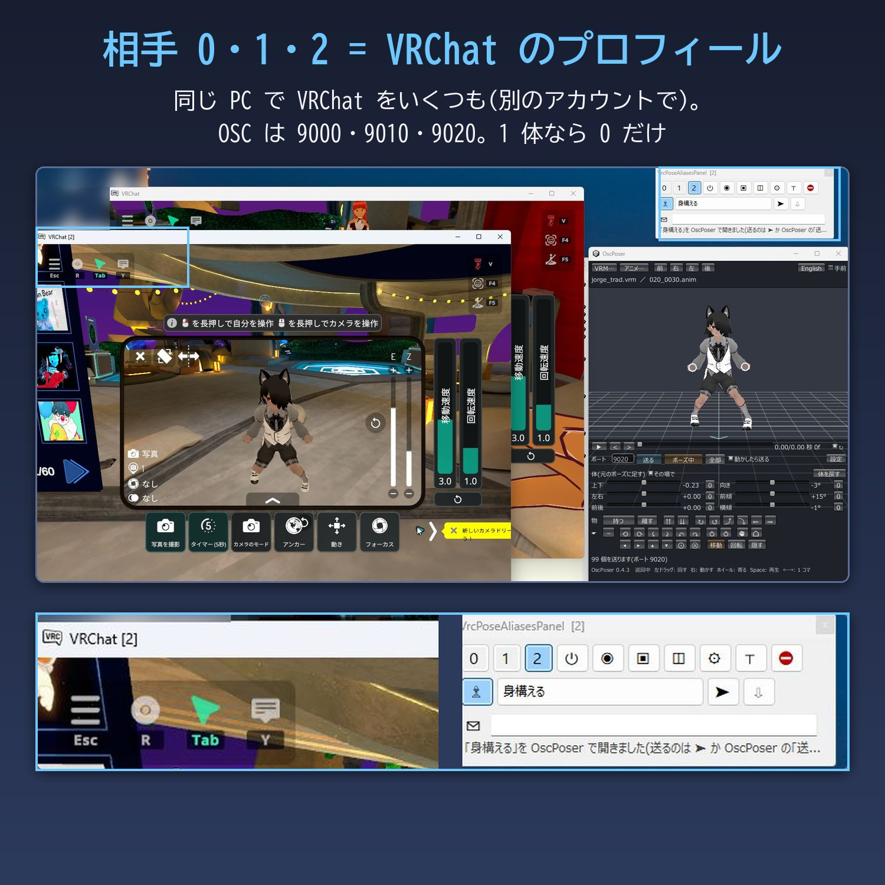

# VrcPoseAliasesPanel

[English](README.en.md)

VRChat のアバターに、名前を付けて登録したポーズ(**エイリアス**)を選んでとらせる、小さな操作パネルです。

これは **[OscPoser](https://github.com/JRF-2018/osc_poser) の操作の口(MCP と同じ口)を使う例** として作ったものです。ポーズを VRChat に送るのは OscPoser で、このパネルは OscPoser に「このポーズを開いて」「送って」と頼むだけです。AI(Claude Code など)が MCP で OscPoser を操作するのと同じことを、ボタンでやっています。

逆に、**OscPoser を使うのに、このパネルは要りません**。OscPoser は単体で、.anim を開いて送れます。このパネルは、よく使うポーズに名前を付けて並べておき、すぐ選べるようにするためのものです。作者(JRF)は、これにもう少し機能を足したもの(歩かせる・物を持たせる、など)を、ふだんワールドの撮影に使っています。



このパネルは単体で完結した道具ではなく、**使い始めるには少し手間がかかります**。OscPoser を入れて動かせること、ポーズ(エイリアス)を自分で登録していくこと、が前提です。この README を一通り読んでから使ってください。

- パネル: `VrcPoseAliasesPanel.exe`(C# の WinForms。Windows に入っている .NET Framework 4.8 で動きます)
- ビューアー: `VrmPoseViewer\VrmPoseViewer.exe`(VRM にポーズを当てて見る。エイリアスの登録・編集と、アニメーションの取り込みもここで)

## できること

- 相手 **0・1・2**(VRChat のプロフィール番号。下の「[プロフィール 0・1・2](#profiles)」)を選んで:
  - ⏻ その番号の VRChat を起動する
  - ポーズの一覧(`pose_aliases.txt`)から選ぶと OscPoser で開き、➤ で VRChat に送る。♙ で任意ポーズを入れる・切る、⇩ で今のポーズを保存
  - ✉ チャット(VRChat のチャットボックス)
  - ◉ VRChat の窓を撮る(AI に見せるときなどに。パスがクリップボードに入ります)
- ▣ ビューアーで、ポーズを見る・エイリアスを登録する・名前やグループを変える・アニメーションを取り込む

## 必要なもの

- Windows 10 / 11
- [OscPoser](https://github.com/JRF-2018/osc_poser) **0.4.0 以降**(exe と、アバターに入れる prefab)。OscPoser の README のとおり、ポーズをとらせたいアバターに prefab を入れてアップロードし、OscPoser 単体でポーズが送れることを先に確かめてください。
- VRChat(デスクトップでも VR でも)

## 入れ方

1. zip を展開して、好きな場所に置きます(例: `D:\VrcPoseAliasesPanel_0.1.0\`)。
2. OscPoser の zip も展開し、**このフォルダの中か横に**、`OscPoser_<版>` のフォルダのまま置きます。そうすれば自動で見つけます(zip を「すべて展開」してできる二重のフォルダでもかまいません)。別の場所に置いたときは、起動したときに場所を聞かれるので `OscPoser.exe` を選んでください(⚙ でも変えられます)。
3. `VrcPoseAliasesPanel.exe` を起動します。OscPoser が動いていなければ、パネルが OscPoser を開きます。
4. ▣ でビューアーを開き、**最初に VRM をドロップ**します(「VRM を開く…」でも)。ポーズを確かめるのに使います(OscPoser の VRM とは別に覚えます)。

例のエイリアスを使うなら、続けて下の「[例: ねここやさんの無料のポーズ・エモート](#example)」も。

## 使い方

1. パネルの **0・1・2** で相手を選ぶ(ふつうに起動した VRChat なら 0)。
2. ポーズのボタン(「(ポーズを選ぶ)」)を押し、メニューからポーズを選ぶ。OscPoser の窓に、そのポーズが出ます(まだ VRChat には送っていません)。
3. ➤ を押すと VRChat に送られ、アバターがそのポーズになります(OscPoser の「送る」と同じ)。やめるときは ♙ で任意ポーズを切ります。

OscPoser の窓では、送る前に体の向き・高さを変えたり、手を動かしたり(上級機能)できます。細かいことは OscPoser の側で、ポーズを選ぶのはパネルで、という分担です。

### 画面の項目

| | |
|---|---|
| 0 1 2 | 相手(VRChat のプロフィール番号)。起動・ポーズ・チャットはこの相手に。OscPoser の相手も切り替わる |
| ⏻ | 選んでいる番号の VRChat を起動する(Steam の launch.exe を自動で探す) |
| ◉ | VRChat の窓(または画面全体)を撮る。`shots\` に PNG、パスはクリップボードへ |
| ▣ | ビューアーを開く(選んでいるポーズを表示した状態で) |
| ◫ | OscPoser の窓を前に出す(動いていなければ開く) |
| ⚙ | 設定(OscPoser・launch.exe の場所、デスクトップモードで起動するか、画面の言語など) |
| ⊤ | いつも手前に表示 |
| ⛔ | OscPoser のまだ送っていない分をやめる |
| ♙ | 任意ポーズを入れる・切る |
| (ポーズを選ぶ) | ポーズのメニュー。選ぶと OscPoser で開く |
| ➤ | 今のポーズを VRChat に送る |
| ⇩ | 今のポーズ(OscPoser で手などを直したものも)を `poses\<名前>.json` に保存 |
| ✉ | チャット(Enter で送る) |
| 下の行 | 最近の記録。マウスを乗せると最近の記録、ダブルクリックで記録をコピー |

パネルに `.vrm` をドロップすると、OscPoser のその相手の VRM になります。

<a id="aliases"></a>
## エイリアス(pose_aliases.txt)

パネルのポーズの一覧は、このフォルダの **`pose_aliases.txt` そのもの** です。エイリアスは「ポーズに付けた名前」で、中身は次のどれかです。

- **anim**: アニメーション(Unity の人型の `.anim`、テキスト形式)と、その中の時刻
- **pose**: 保存したポーズ(`poses\<名前>.json`。⇩ や OscPoser で保存したもの)

**お気に入りのポーズを集めて、自分の `pose_aliases.txt` を作っていくのがおすすめです。** 付属の例はたくさんありすぎるので、使うものだけ残して、自分の名前・グループに並べ替えてください。



### 書き方

```
# # から行末はコメント
立ち(基本)    anim  anim/nccy_pose_free/000_0000_Idle.anim
腰に手        anim  anim/nccy_pose_free/010_0090.anim
手を振る      anim  anim/nccy_emote_free/01_tefuri1.anim  2.57
いつものピース pose  my_peace

[座り]
あぐら        anim  anim/nccy_pose_free/011_0070.anim
"名前 に 空白"  anim  "D:\My Anims\sit 01.anim"  f30
```

- 1 行に `エイリアス名  種類  対象  [時刻]`。区切りは空白(いくつでも)。空白を含むものは `"..."` で囲みます。
- 種類 `anim` の対象は `.anim` のパス。このフォルダからの相対(`anim/...`)か、絶対パス。
- 種類 `pose` の対象は `poses\` に保存したポーズの名前(`.json` は付けない)。
- 時刻は、秒(`1.6`)、フレーム(`f30`)、最後(`end`)。省略すると最後。動きのあるアニメーション(エモートなど)は、とらせたい瞬間の時刻を書きます。
- `[グループ名]` の行から次の `[...]` までがそのグループで、パネルではサブメニューになります。最初の `[...]` より前(ルート)は、メニューのいちばん上に並びます。
- **並びは、ファイルに書いた順** です(グループも、その中も)。
- まったく同じ行(名前・種類・対象・時刻がすべて同じ)を別のグループにも書けば、両方のグループに出ます。

### 編集のしかた

- **並べ替え・まとめて消す・グループを作り直す などは、`pose_aliases.txt` を直接編集してください。** ビューアーの「pose_aliases.txt をメモ帳で編集」で開けます。保存すると、ビューアーの一覧は自動で読み直されます。パネルのメニューは開くたびに読み直します。
- 1 つずつ足す・名前を変える・グループに入れるのは、ビューアーでもできます:
  - **登録…**: 今見ているポーズ(アニメーションとその時刻、または保存したポーズ)を、名前とグループを付けて登録します。ほかの場所のアニメーションは、`anim\` にコピーしてから登録します(ファイル名は別に決められます)。
  - **編集…**: 選んでいるエイリアスの名前・グループ・時刻を変える、エイリアスから外す(ファイルは消しません)。
  - ビューアーは、書き換えない行(コメントなど)はそのまま残します。
- 手持ちの `.anim` は、ビューアーにドロップ(1 つずつ)するか、`.unitypackage`・`.zip`・フォルダごとドロップすると、中のアニメーションが一覧に出ます。見ながら時刻を決めて「登録…」。

<a id="example"></a>
## 例: ねここやさんの無料のポーズ・エモート

付属の `pose_aliases.txt` には、ねここや(かんな久)さんの無料のアセットのポーズ・エモートを 320 個登録してあります。**アニメーションそのものは入っていない** ので、入手して取り込んでください。

1. 次の 2 つの無料版を Booth で入手します(zip のままでかまいません)。
   - [ポーズ詰め合わせ](https://necocoya.booth.pm/items/1634088)(`NCCY_PoseSet_Free_v200.zip` など)
   - [Emote詰め合わせ](https://necocoya.booth.pm/items/1065089)(`EmoteSet_Free_v130.zip` など)
2. ▣ でビューアーを開くと「アニメーションの取り込み」の画面が出ます(上の「取り込み…」でいつでも開けます)。入手した zip をこの窓にドロップするか、「参照…」で選んで「取り込む」。
3. 登録してあるアニメーションだけが `anim\` に取り込まれます。

名前は、作者のカタログの題と説明書の動作名を使い、題のないものは見た目から付けました。一部は言い換えています。エモート(動きのあるもの)は、動きの中の 1 つの時刻を選んであります。

取り込み元は `anim_sources.txt` に書いてあります(`フォルダ  パッケージの中のパスの頭  名前  [入手先]`)。アセットの版が上がっても、ファイル名が同じなら取り込めます。ほかのアセットの取り込み元を自分で書き足すこともできます。

<a id="profiles"></a>
## プロフィール 0・1・2(相手)

VRChat は、起動するときに `--profile=N` を付けると、別のプロフィール(ログイン情報・設定)で動きます。これで **同じ PC で VRChat をいくつも同時に動かせます**(ただし 1 つのアカウントは同時に 1 か所にしかログインできないので、それぞれ別のアカウントでログインします)。

このパネルの **0・1・2 は、そのプロフィール番号** です。それぞれの VRChat は、別々の OSC のポートで受けます。



| 相手 | 起動のしかた(⏻) | OSC(受信 / 送信) |
|---|---|---|
| 0 | ふつうの起動と同じ | 9000 / 9001 |
| 1 | `--profile=1 --osc=9010:127.0.0.1:9011` | 9010 / 9011 |
| 2 | `--profile=2 --osc=9020:127.0.0.1:9021` | 9020 / 9021 |

- **1 体だけで使うなら 0 だけ** で足ります(Steam などからふつうに起動した VRChat が 0 です)。
- 使い方の例: 0 = ポーズをとらせるアバター、1 = 撮影するカメラ役のアカウント(自分で操作する。OscPoser の prefab は要りません)、2 = 2 体目のアバター。
- ⏻ は、選んでいる番号でそのまま起動します。初めての番号では VRChat のログインから始まります。デスクトップモード(`--no-vr`)で起動するかは ⚙ で選べます(既定は入り)。
- 起動した VRChat の窓のタイトルは「VRChat [N]」に変わります(どの窓がどの番号か分かるように)。◉ で撮るときも、番号で窓を探します。
- OscPoser も 0・1・2 の 3 つの相手を持つ形(`-targets 9000,9010,9020`)で開き、パネルで相手を切り替えると OscPoser の相手も切り替わります。VRM・ポーズは相手ごとに覚えます。
- いくつも動かすと PC が重くなります。ポーズをとらせるだけの VRChat は、画質を下げ、窓を小さくするとよいです。

<a id="mcp"></a>
## AI から使う(MCP)

このパネルは、OscPoser の操作の口(`-api`、HTTP。既定のポート 9330)を使っています。OscPoser は同じ口で MCP も受けるので、AI(Claude Code など)は MCP で OscPoser を直接操作できます(つなぎ方は OscPoser の README の「AI から使う(MCP)」)。

たとえば、パネルで VRChat と相手を用意し、ポーズは AI に作ってもらう(OscPoser の MCP で開く・手を動かす・撮って見る・送る)、できたポーズは ⇩ や AI の `save_pose` で `poses\` に保存して、`pose_aliases.txt` に登録する、という使い方ができます。

パネル自体のコードは短い(`src/PanelForm.cs`)ので、OscPoser を操作する自分用のツールを作るときの手本にもなります。

## 設定と、できるファイル

- ⚙: OscPoser.exe の場所(空なら自動で探す)、VRChat の launch.exe の場所(空なら Steam のライブラリから探す)、デスクトップモードで起動するか、OscPoser の操作の口のポート(既定 9330)、画面の言語(Windows に合わせる・日本語・English)。
- このフォルダにできるもの: `VrcPoseAliasesPanel.json`(設定)、`VrcPoseAliasesPanel_log.txt`(記録)、`anim\`(取り込んだ・コピーしたアニメーション)、`poses\`(保存したポーズ)、`shots\`(撮った画像)。
- ビューアーの設定(前に開いた VRM など)は Windows のレジストリ(`HKEY_CURRENT_USER\Software\JRF\VrmPoseViewer`)に入ります。

## うまくいかないとき

- **ポーズを選んでも VRChat で変わらない**: ➤ で送りましたか(選ぶだけでは送りません)。OscPoser 単体で送れるか、アバターに prefab が入っているかを確かめてください。相手(0・1・2)と、送りたい VRChat の番号が合っているかも。
- **「アニメーションがありません」**: まだ取り込んでいないか、`anim\` のファイルを消したか移したか。ビューアーの「取り込み…」で取り込めます。
- **OscPoser とつながらない**(タイトルに「(OscPoser なし)」): ◫ で開けます。OscPoser が 0.4.0 より前だと、操作の口がありません。ほかで OscPoser を `-api` なしで開いていると、パネルからは使えません(閉じてから ◫)。
- **⏻ で起動しない**: ⚙ で `launch.exe`(VRChat のインストール先の `launch.exe`)の場所を指定してください。

## ソースから作る(開発者向け)

- パネル: `build.ps1`。.NET の SDK がなくても、Unity(2022.3)に付いている C# のコンパイラーでビルドします(`-Unity` で Unity の Editor フォルダを指定)。
- ビューアー: `viewer/`(Unity 2022.3.22f1 のプロジェクト。UniVRM 0.128.1 を使う)。`viewer/build.ps1`。

## Author (文責)

JRF ( http://jrf.cocolog-nifty.com/statuses , Twitter (X): @jion_rockford )
AI

Claude Opus 5.5 がほとんどを書きました。

## ライセンス

MIT License（LICENSE）.

ビューアーには UniVRM(MIT License)などが入っています。[THIRD_PARTY_NOTICES.md](THIRD_PARTY_NOTICES.md) を見てください。

付属の `pose_aliases.txt` の例は、ねここやさんのアセットの名前と場所だけを書いたもので、アニメーションは含みません。アセットの利用は、それぞれの規約に従ってください。
